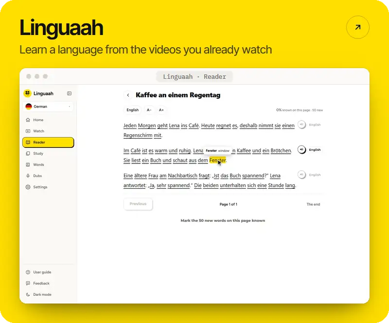
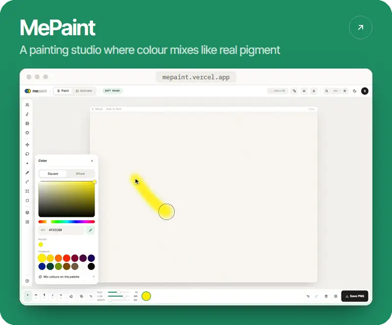
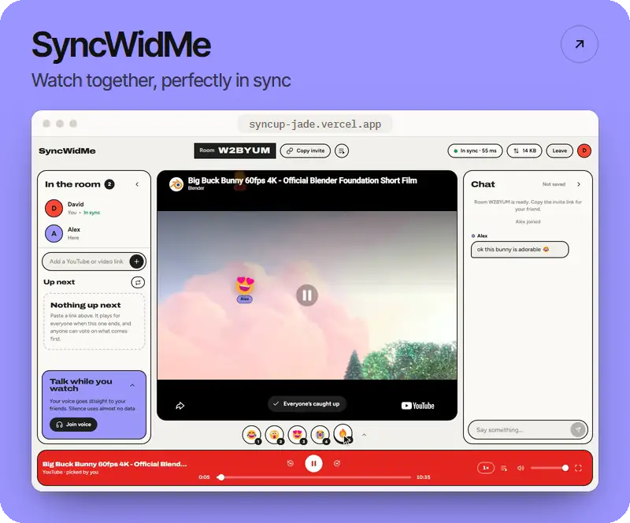
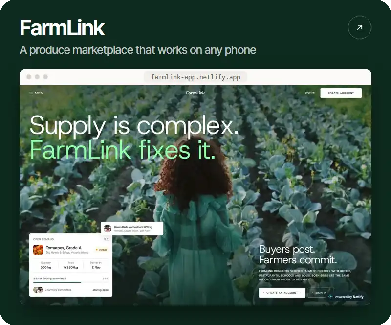
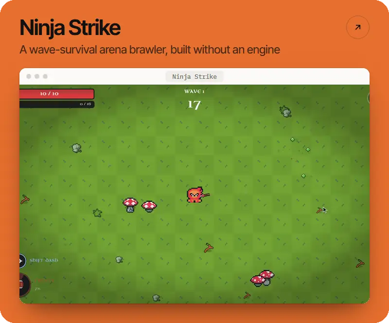
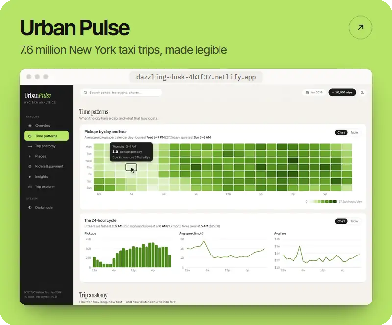

<a href="https://david-muo-portfolio.vercel.app">
  <picture>
    <source media="(prefers-color-scheme: dark)" srcset="assets/banner-dark.svg">
    
  </picture>
</a>

  <a href="https://david-muo-portfolio.vercel.app"><b>Portfolio</b></a>&nbsp;&nbsp;·&nbsp;&nbsp;<a href="https://david-muo-portfolio.vercel.app/#contact"><b>Start a project</b></a>

### Selected work

  
  
  
  
  
  

- **[HouseSlice](https://github.com/davidmuo/houslice)** · Student housing with a compatibility score
- **[Anza](https://github.com/davidmuo/anza)** · A verified hub for campus events and opportunities
- **[PixelSynth](https://pixelsynth-six.vercel.app)** · Paint notes on a grid and hear them play
- **[MoMo Dashboard](https://github.com/davidmuo/MOMO_app)** · Mobile-money SMS exports, turned into a financial dashboard
- **[Arena Defender](https://github.com/davidmuo/arena-defender)** · A 2D survival game in C# and MonoGame

### Toolkit

<picture>
  <source media="(prefers-color-scheme: dark)" srcset="https://skillicons.dev/icons?i=figma%2Cts%2Creact%2Cnextjs%2Ctailwind%2Cflutter%2Cdart%2Cnodejs%2Cpy%2Cflask%2Cpostgres%2Cprisma%2Csupabase%2Cfirebase%2Cthreejs%2Ccs&perline=16&theme=dark">
  
</picture>

  

<picture>
  <source media="(prefers-color-scheme: dark)" srcset="https://raw.githubusercontent.com/davidmuo/davidmuo/output/snake-dark.svg">
  
</picture>
